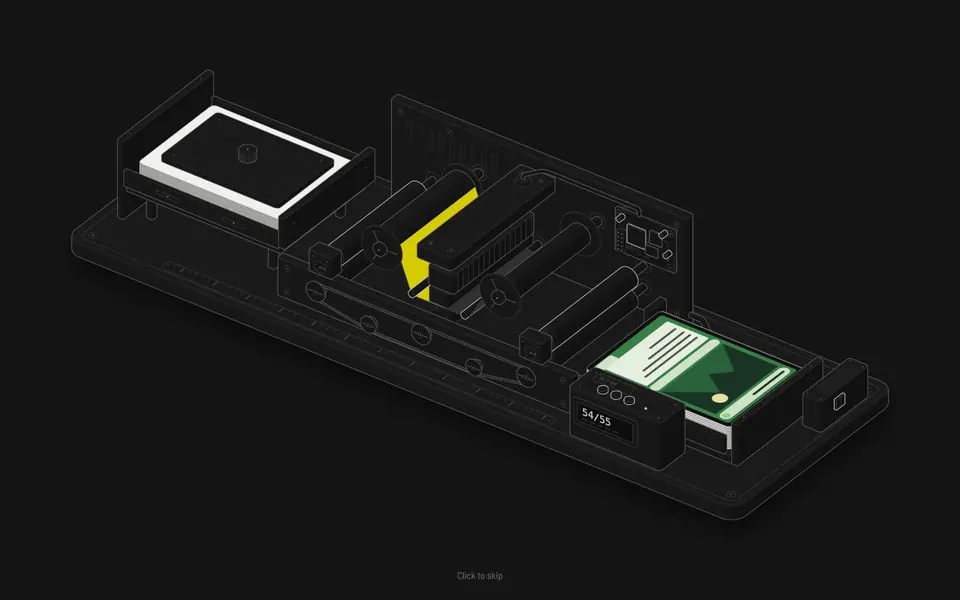

# Black Lotus Press

**Your Moxfield deck, printed.** Black Lotus Press is a free desktop app that turns [Moxfield](https://moxfield.com) decks into print-ready PDFs for the custom playing cards of [meinspiel.de](https://www.meinspiel.de/selbstgestaltete-spielkarten-mit-fotos-gestalten-drucken/) and uploads them to your account, or sends them to the designers of [notmpc.eu](https://notmpc.eu/de/) and [printerstudio.de](https://www.printerstudio.de/machen/blanko-spielkarten-63x88mm-personalisieren.html). It takes the exact printings from [Scryfall](https://scryfall.com) or high-resolution images from [MPC Autofill](https://mpcfill.com), cleans them up, upscales them with [Upscayl](https://github.com/upscayl/upscayl-ncnn) and makes them in the colours and size each shop asks for.



**[Download](https://github.com/balatD/black-lotus-press/releases/latest)** for macOS (Apple Silicon), Windows and Linux · **[Website](https://balatd.github.io/black-lotus-press/)** · **[Documentation and FAQ](https://balatd.github.io/black-lotus-press/docs.html)**

> **On a Mac:** the app is not signed with an Apple certificate, so macOS says it "is damaged" or that Apple "could not verify" it. It is neither. Drag it into Applications, then run this once in Terminal (and again after every update):
>
> ```bash
> xattr -cr "/Applications/Black Lotus Press.app"
> ```

## What it does

- Imports Moxfield decks with the boards you choose, and offers non-foil printings for the deck's foils.
- Lets you check and edit every card: quantities, the print order, brightness and contrast, and in one card editor its image. Printings with prices, MPC Autofill images and own images show large, next to the Scryfall scan and zoomable to the pixel.
- Shows every pack or deck as a press sheet, fronts and backs.
- Cleans up the scans, adds 3 mm bleed, handles the copyright line, upscales to 600 dpi and makes the print images: CMYK with ISO Coated v2 for meinspiel.de, sRGB for the other shops.
- Opens the shops in a browser window that looks like part of the app, with a panel that lists every step of the hand-over and how far the upload is, and points you to the login form.
- Writes two PDFs per pack and uploads them to your meinspiel.de account. You log in and order yourself; the app never sees your password and never pays anything.
- For notmpc.eu, uploads RGB images and fills their designer with every card of a deck in its slot; you choose the options and order there. notmpc.eu is not available at the moment.
- For printerstudio.de, lets you log in, uploads RGB images, fills their designer for 63 × 88 mm cards on Standard stock up to the preview and saves every deck in your account; you confirm the copyright and put the decks into the cart.
- Moves an order to another shop, or copies it there, with its cards, images and edits; the upscaled images are kept.
- Exports an order as a file to share, with or without the upscaled images, and imports such files.
- Offers all card backs of MPC Autofill in a searchable gallery.
- Saves an order as an MPC Autofill XML for MPC Autofill's desktop tool and its editor.
- Swaps the Scryfall scan of a card for a high-resolution image from [MPC Autofill](https://mpcfill.com) and recognises which printing each image shows, so custom art stays apart.

The [documentation](https://balatd.github.io/black-lotus-press/docs.html) explains every step and answers common questions.

## Development

Requires Node.js 24 and Google Chrome or Microsoft Edge.

```bash
npm ci
npm run gui:dev        # the app from the sources
npm run dev            # the command-line edition
```

| Script | Does |
|---|---|
| `npm test` | Unit tests of the core in `src/` |
| `npm run typecheck:app` | Type checks the app |
| `npm run test:e2e` | Builds the app and runs the end-to-end tests in Electron |
| `npm run gui:package` | Builds the app for this system into `release/` |
| `npm run test:packaged` | Starts the built app from `release/` and checks it works |
| `npm run build` | Builds the command-line edition into `dist/` |

During development the app and the command-line edition keep their profiles and orders in the project folder. The core lives in `src/`, the Electron app in `app/`, the website in `site/`.

### Releases

The [Build workflow](.github/workflows/build.yml) runs the tests, builds the app and the command-line edition for every system and starts each built app once. Pushing a version tag such as `v1.0.0` turns the result into a draft release with the notes from [CHANGELOG.md](CHANGELOG.md). Publishing the draft also updates the website.

The builds are not signed with a paid certificate, so macOS and Windows warn before the first start; the note above and the documentation explain how to open them.

## Credits

Based on [MPC Proxy Forge](https://github.com/benedikt-wueller/mpc-proxy-forge) by Benedikt Wüller. Card data and images from [Scryfall](https://scryfall.com), decks from [Moxfield](https://moxfield.com), card backs and high-resolution card images from [MPC Autofill](https://mpcautofill.github.io), upscaling by [Upscayl](https://github.com/upscayl/upscayl-ncnn). The splash screen's card printer is drawn with Ryan's Anatomy isometric kit ([MIT](tools/anatomy/LICENSE)).

## License

[MIT](LICENSE). The website's typeface, Barlow Semi Condensed, is under the [SIL Open Font License](site/fonts/OFL.txt).

Black Lotus Press is unofficial Fan Content permitted under the Fan Content Policy. Not approved/endorsed by Wizards. Portions of the materials used are property of Wizards of the Coast. ©Wizards of the Coast LLC. Not affiliated with meinspiel.de, notmpc.eu, printerstudio.de, Moxfield, Scryfall or MPC Autofill.
