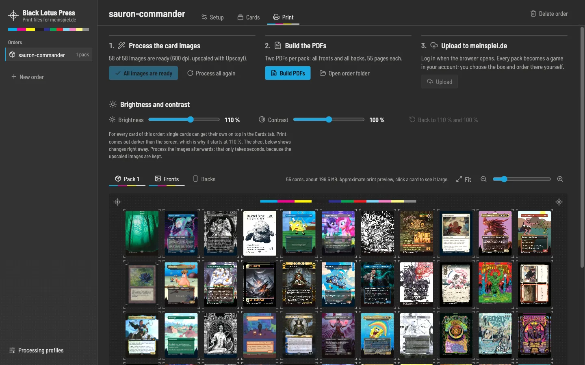

# Black Lotus Press

**Your Moxfield deck, printed.** Black Lotus Press is a free desktop app that turns [Moxfield](https://moxfield.com) decks into print-ready PDFs for the custom playing cards of [meinspiel.de](https://www.meinspiel.de/selbstgestaltete-spielkarten-mit-fotos-gestalten-drucken/) and uploads them to your account. It takes the exact printings from [Scryfall](https://scryfall.com), cleans them up, upscales them with [Upscayl](https://github.com/upscayl/upscayl-ncnn) and converts them to the printer's CMYK.



**[Download](https://github.com/balatD/black-lotus-press/releases/latest)** for macOS (Apple Silicon), Windows and Linux · **[Website](https://balatd.github.io/black-lotus-press/)** · **[Documentation and FAQ](https://balatd.github.io/black-lotus-press/docs.html)**

> **On a Mac:** the app is not signed with an Apple certificate, so macOS says it "is damaged" or that Apple "could not verify" it. It is neither. Drag it into Applications, then run this once in Terminal (and again after every update):
>
> ```bash
> xattr -cr "/Applications/Black Lotus Press.app"
> ```

## What it does

- Imports Moxfield decks with the boards you choose, and offers non-foil printings for the deck's foils.
- Lets you check and edit every card: printings with prices, quantities, the print order, own images, brightness and contrast.
- Shows every pack as a press sheet of 55 cards, fronts and backs.
- Cleans up the scans, adds 3 mm bleed, handles the copyright line, upscales to 600 dpi and converts to CMYK with meinspiel.de's ISO Coated v2 profile.
- Writes two PDFs per pack and uploads them to your meinspiel.de account. You log in and order yourself; the app never sees your password and never pays anything.

The [documentation](https://balatd.github.io/black-lotus-press/docs.html) explains every step and answers common questions.

## Development

Requires Node.js 24 and Google Chrome or Microsoft Edge.

```bash
npm ci
npm run gui:dev        # the app from the sources
npm run dev            # the command-line edition
```

| Script | Does |
|---|---|
| `npm test` | Unit tests of the core in `src/` |
| `npm run typecheck:app` | Type checks the app |
| `npm run test:e2e` | Builds the app and runs the end-to-end tests in Electron |
| `npm run gui:package` | Builds the app for this system into `release/` |
| `npm run test:packaged` | Starts the built app from `release/` and checks it works |
| `npm run build` | Builds the command-line edition into `dist/` |

During development the app and the command-line edition keep their profiles and orders in the project folder. The core lives in `src/`, the Electron app in `app/`, the website in `site/`.

### Releases

The [Build workflow](.github/workflows/build.yml) runs the tests, builds the app and the command-line edition for every system and starts each built app once. Pushing a version tag such as `v1.0.0` turns the result into a draft release with the notes from [CHANGELOG.md](CHANGELOG.md). Publishing the draft also updates the website.

The builds are not signed with a paid certificate, so macOS and Windows warn before the first start; the note above and the documentation explain how to open them.

## Credits

Based on [MPC Proxy Forge](https://github.com/benedikt-wueller/mpc-proxy-forge) by Benedikt Wüller. Card data and images from [Scryfall](https://scryfall.com), decks from [Moxfield](https://moxfield.com), card backs from [MPC Autofill](https://mpcautofill.github.io), upscaling by [Upscayl](https://github.com/upscayl/upscayl-ncnn).

## License

[MIT](LICENSE). The website's typeface, Barlow Semi Condensed, is under the [SIL Open Font License](site/fonts/OFL.txt).

Black Lotus Press is unofficial Fan Content permitted under the Fan Content Policy. Not approved/endorsed by Wizards. Portions of the materials used are property of Wizards of the Coast. ©Wizards of the Coast LLC. Not affiliated with meinspiel.de, Moxfield, Scryfall or MPC Autofill.
